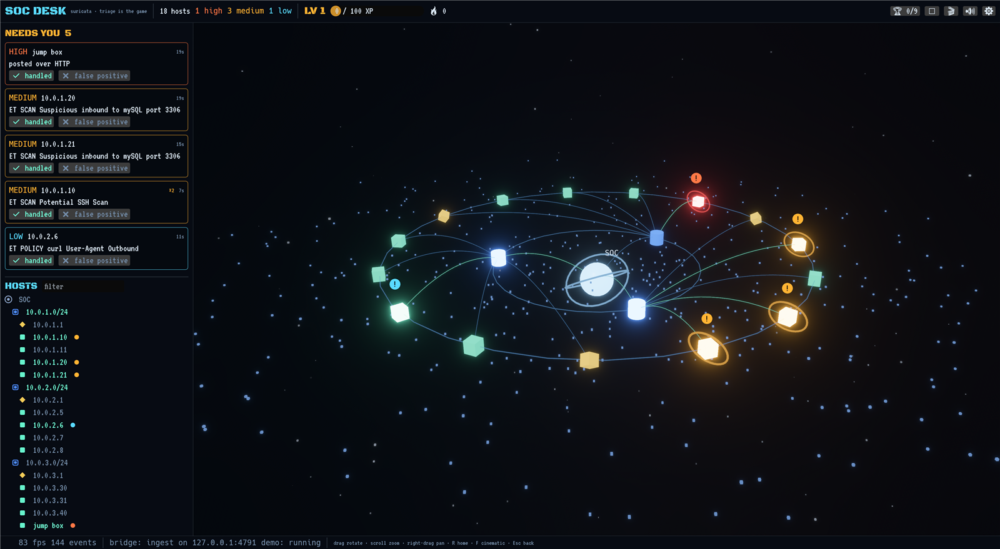

# GAE — Gamify Any Environment

A Rust + Bevy engine kit that turns any work domain into a live 3D constellation with a
Needs-You queue and a game loop: things that need you light up, you handle them, you level up.
It's the general version of [Agent Globe](https://github.com/MrFo2sh/agent-globe).

- **Units** (hosts, repos, services, targets) orbit a core, grouped on rings. Shape shows the
  kind; color and halos show the status.
- **Actions** (requests, builds, scans) pulse along beams while they run.
- **Signals** (alerts, red builds, findings) land in the Needs-You queue with a badge over their unit.
- **The game**: resolving pays XP by severity, double if fast; a streak counts handled signals
  and breaks when one goes stale; levels, achievements, sounds, a level-up flash.



## 60-second quickstart

Needs Rust stable (MSVC on Windows). The first build compiles Bevy (a few minutes).

```
git clone https://github.com/MrFo2sh/gae && cd gae
cargo run --release -p soc-desk -- --demo
```

Hosts appear in three subnets, Suricata-style alerts start arriving, and the queue fills. Press
**✔ handled** on the critical one. Drag to rotate, scroll to zoom, click a unit to inspect it,
**R** to reset the view, **F** for cinematic mode, **F11** for full screen.

Feed it your own events from anywhere:

```
curl -X POST http://127.0.0.1:4791/events --data-binary '{"type":"signal","id":"t1","unit":"10.0.9.9","severity":"high","title":"hello"}'
curl http://127.0.0.1:4791/state
```

## Make your own environment

```
powershell -NoProfile -File tools/new-env.ps1 -Slug homelab-ops -Title "Homelab Ops"
cargo run -p homelab-ops -- --demo
```

Then edit `envs/homelab-ops/src/domain.rs` (names, kinds, colors, XP rules, achievements)
and `src/source.rs` (map your feed's lines to events, and write a demo timeline).
[AGENTS.md](AGENTS.md) is the step-by-step playbook: give a coding agent this folder and a
one-line idea, and it builds the environment.

## Event schema

JSON, one object, an array, or newline-delimited. `at` (epoch millis) is optional everywhere.

| `type` | Fields | Meaning |
|---|---|---|
| `unit_up` | `unit`, `parent?`, `kind?`, `label?`, `meta?` | A unit appears or changes. Unknown parents are created under the core. |
| `unit_down` | `unit` | It finished or left (dimmed). |
| `action_start` | `unit`, `action`, `kind?`, `summary?` | Work begins (tracers run). |
| `action_end` | `unit`, `action`, `ok?` (true), `output?` | Work ends; no start is fine. |
| `signal` | `id`, `unit`, `severity?` (`info`…`critical`), `title`, `detail?`, `kind?` | Needs the human. The same `id` while open counts as a repeat. |
| `resolve` | `id`, `note?` | The source cleared it. |
| `artifact` | `unit`, `target`, `kind?`, `label?` | Something produced or touched (URL, IOC, file). |
| `metric` | `unit`, `name`, `value` | Latest value wins. |
| `log` | `text`, `unit?`, `level?` | A line for the log. |

HTTP listens on `127.0.0.1` only, refuses browser requests (any `Origin` header), caps bodies at
4 MB and 10,000 events per request, and answers 503 when the app is behind.

## Environments in this repo

### SOC Desk (`envs/soc-desk`)

A blue-team desk over Suricata's `eve.json`. Internal addresses become hosts under their /24;
the gateway (.1) is a diamond. Alerts are signals keyed by signature and host, so a scan that
fires a hundred times is one queue item marked ×100. Trojan, C2 and privilege-gain categories
are always critical. DNS, HTTP, TLS, flows and files are actions; domains, files and external
IPs are artifacts on the host.

```
soc-desk --eve /var/log/suricata/eve.json      # follow new lines
soc-desk --eve eve.json --from-start           # replay a capture
soc-desk --demo                                # scripted timeline, no sensor
```

## Layout

```
crates/gae-core     events, world, layout, game rules, sources, bridge (no Bevy)
crates/gae-engine   scene, camera, UI, cards, sounds, settings (Bevy 0.20 + egui 0.36)
envs/_template      copied by tools/new-env.ps1
envs/soc-desk       the worked example
```

Settings and game progress: `%APPDATA%\gae\<env>\` (`settings.json`, `game.json`, and
`sounds\<cue>.wav` to replace any sound).

## License

MIT. Fonts: VT323 and Black Ops One, SIL Open Font License (see `crates/gae-engine/assets/fonts`).
